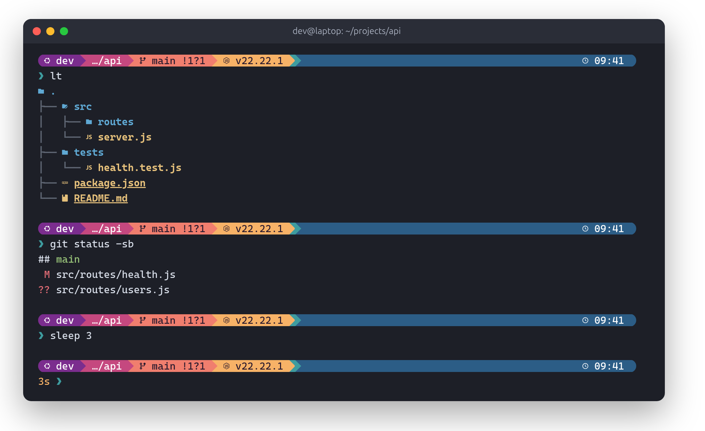
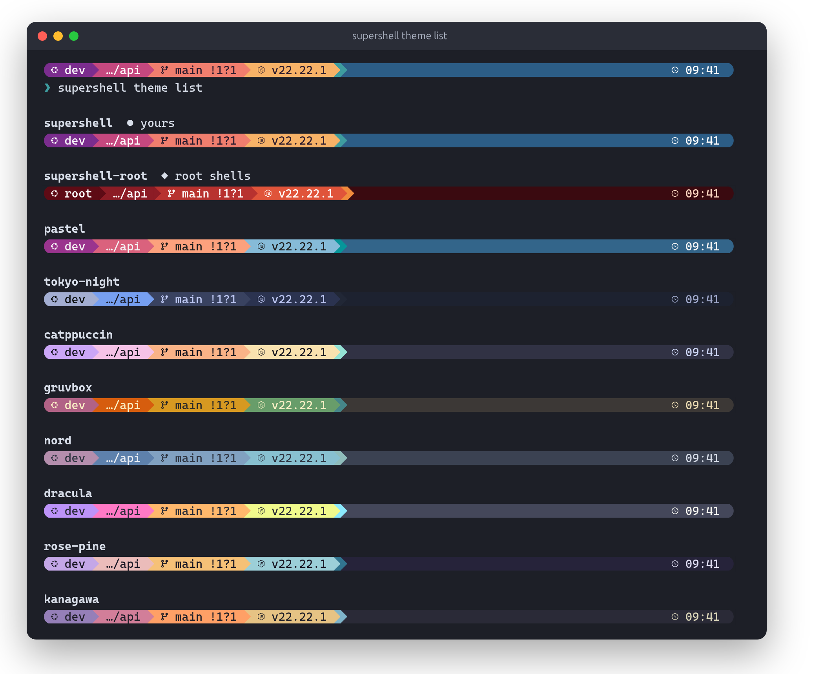
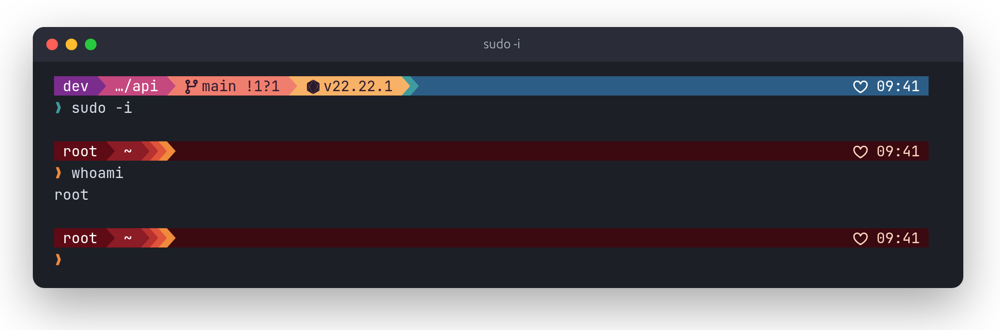
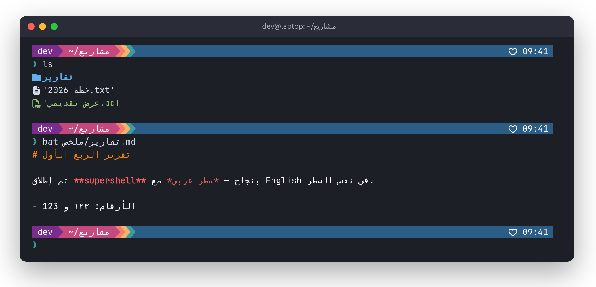

<div dir="rtl">

# supershell

**بيئة Bash حديثة ومدروسة لـ Ubuntu 26.04.** سطر أوامر أنيق، وبحث ذكي، وتنقّل سريع بين المجلدات، وعرض واضح لتغييرات Git، ومحرر Neovim جاهز للعمل، ومعلومات DevOps في الـ prompt. ومع كل هذا تظل الـ shell عندك Bash عاديًا، وكل الأوامر الأساسية تعمل تمامًا كما تعمل على أي جهاز أو سيرفر Ubuntu آخر.

[English](README.md) · [دعم اللغة العربية](docs/arabic.md) · [لماذا اخترنا هذه الأدوات](docs/technology-selection.md)

<p align="center"></p>

## المبادئ

- **Bash يظل Bash.** لا نعيد تعريف `ls` أو `cat` أو `grep` أو `find` أو `cd` أو `vi` أبدًا. الأدوات الجديدة لها أسماء خاصة بها (`ll` و`bat` و`rg` و`z`). والـ scripts و`scp` و`rsync` لا تتأثر، لأن supershell لا يعمل إلا في الـ shell التفاعلية.
- **سطر واحد في `~/.bashrc`.** داخل block واضح العلامات، مع نسخة احتياطية قبل التعديل، ويُحذف عند الإزالة فيعود الملف كما كان بالضبط.
- **سريع.** لا framework ولا عمليات تعمل في الخلفية ولا اتصال بالإنترنت عند فتح الـ terminal. والأمر `supershell bench` يقيس التكلفة الحقيقية على جهازك.
- **آمن للتجربة.** كل تشغيل يُعامَل كوحدة واحدة: لو فشل أي جزء أو ضغطت Ctrl-C يرجع كل شيء كما كان. والأمر `supershell mode classic` يرجعك إلى Bash الأصلي فورًا.
- **العربية مُختبَرة**، وحدودها موثّقة بصراحة.

## التثبيت

```bash
git clone https://github.com/saeed-morshidy/supershell.git
cd supershell
./supershell install --dry-run   # يعرض ما سيُثبَّت ومن أين، بدون تنفيذ أي شيء
./supershell install
```

أول تثبيت يسألك سؤالين:

- **شكل الـ prompt** — *supershell-theme* (الافتراضي): ثيم supershell الخاص — شريط ألوان بعرض الـ terminal كله، وطرفاه مربّعان، والساعة على اليمين — أو *starship*: شكل pastel-powerline [كما ينشره starship](https://starship.rs/presets/) بالضبط. الخياران `--custom` و`--default`، وترجع للافتراضي في أي وقت بـ `supershell theme reset`.
- **خط الـ terminal** — DejaVu Sans Mono (الافتراضي)، أو Cascadia Code، أو JetBrains Mono، أو Fira Code، أو IBM Plex Mono، أو Ubuntu Sans Mono، من أرشيف Ubuntu. الخيار `--font=NAME`، وتقدر تغيّر لاحقًا بـ `supershell font <name>`.

و`--yes` تختار الافتراضي في الاثنين.

بعد التثبيت افتح terminal جديدًا، ثم شغّل `supershell doctor` للتأكد من أن كل شيء سليم.

## الأوامر اليومية

| الأمر | الوظيفة |
|---|---|
| `supershell mode classic` | Bash الأصلي، مناسب وأنت تتابع شرحًا أو كورسًا |
| `supershell mode modern` | تجربة supershell الكاملة |
| `supershell devops on/off` | تشغيل أو إيقاف معلومات DevOps في الـ prompt والـ completion |
| `supershell devops aliases on` | اختصارات مثل `k` و`d` (مُطفأة افتراضيًا، والأفضل أن تتعلم الأوامر كاملة أولًا) |
| `supershell theme` | ثيم supershell (الافتراضي): `theme list` يعرض كل الألوان بشكل الـ prompt الحقيقي، و`theme colors` من غير اسم تختار وأنت شايف، و`theme colors <name>` لتغيير الألوان (supershell، pastel، nord، dracula…)، و`theme root-colors <name>` لألوان الـ root (الافتراضي أحمر `supershell-root`)، و`theme reset` للرجوع للأصل |
| `supershell prompt [<style>]` | أشكال تانية: `pastel-powerline`، `tokyo-night`، `gruvbox-rainbow`، `catppuccin-mocha`… |
| `supershell prompt custom on/off` | شكل supershell (بعرض الشاشة وطرفاه مربّعان — الافتراضي) أو شكل starship كما هو؛ و`prompt cap on` يرجّع البداية المدوّرة |
| `supershell prompt edit` | تعديلاتك أنت على الـ prompt (`~/.config/supershell/prompt.toml`)، وتبقى مع أي شكل وبعد أي تحديث |
| `supershell font [<name>]` | خط الـ terminal (DejaVu Sans Mono، Cascadia Code، JetBrains Mono…)، والعربي دائمًا بعرض ثابت؛ Ptyxis يتحدّث فورًا |
| `supershell root on/off` | نفس شكل الـ prompt وأنت root (`su -` أو `sudo -i`) — نسخ يملكها root، والـ prompt فقط، ويطلب sudo مرة واحدة |
| `supershell keys` | ملخص الاختصارات |
| `supershell doctor` | فحص سلامة البيئة |
| `supershell uninstall` | إزالة كل ما أضافه supershell (ملفاتك الشخصية تبقى كما هي) |

## الوحدات (modules)

الوحدات المُثبَّتة افتراضيًا هي `core` و`git` و`editor` و`fonts` و`devops` و`plus` (اقتراحات وأنت تكتب). والوحدات الاختيارية هي `lazygit` و`helix` و`tmux`.

### استخدام كل وحدة

**`core`** — الأوامر الأصلية (`ls` و`cat` و`grep` و`find`) كما هي، والأدوات الجديدة بأسماء خاصة بها:

| اكتب | الوظيفة |
|---|---|
| `ll` · `la` · `lt` | عرض الملفات مع حالة git والأيقونات · مع المخفية · كشجرة |
| `bat ملف` | مثل `cat` لكن بألوان الكود وأرقام الأسطر |
| `rg "نص"` | بحث سريع داخل الملفات |
| `fd اسم` | بحث عن ملف بالاسم |
| `z مشروع` · `zi` | الانتقال لمجلد زرته قبل كده · اختيار من قائمة |
| `Ctrl-R` · `Ctrl-T` · `Alt-C` | البحث في الأوامر السابقة · إدراج مسار ملف · دخول مجلد |

**`git`** — `git diff` يصبح واضحًا بالألوان (delta)، و`n` / `N` للانتقال بين الملفات.

**`editor`** — `nvim`، ومفتاح القائد **Space** (اضغطه وانتظر تظهر قائمة): `Space f` بحث عن ملف، و`Space /` بحث في المشروع، و`Space e` متصفح الملفات، و`gd` الذهاب للتعريف. التفاصيل في [docs/editor.md](docs/editor.md).

**`fonts`** — `supershell font` لعرض الخطوط و`supershell font cascadia-code` للتغيير.

**`devops`** — الـ prompt يعرض الـ Kubernetes context قبل أي أمر، والـ completion جاهز لـ `kubectl` و`helm` و`docker` و`terraform`. والاختصارات (`k` و`d` و`dc` و`tf`) تشتغل بـ `supershell devops aliases on`.

**`plus`** — اقتراح رمادي وأنت تكتب من أوامرك السابقة: `→` لقبوله. و`Ctrl-R` يفتح Atuin للبحث في الأوامر مع المجلد ونتيجة الأمر، ويبقى على جهازك فقط.

**`lazygit`** — `lg` لواجهة git كاملة. **`helix`** — `hx ملف`. **`tmux`** — `tmux`، والبادئة `Ctrl-B` ثم `|` أو `-` لتقسيم الشاشة.

## ثيم supershell

ثيم supershell الخاص: شريط ألوان بعرض الـ terminal كله، وطرفاه مربّعان، والساعة على اليمين، ومدة الأمر وحالته في السطر الثاني. وله عشر مجموعات ألوان، كل واحدة متدرّجة من جزء لجزء:

<p align="center"></p>

- `supershell theme list` — كل الألوان بشكل الـ prompt الحقيقي.
- `supershell theme colors` — تختار وأنت شايف (الأسهم ثم Enter، وEsc للإلغاء).
- `supershell theme reset` — رجوع للأصل.

والأدوات نفسها تتبع الألوان: `ll` (eza) وfzf وbat وdelta تأخذ ألوانها من نفس المجموعة، وإعداداتك أنت (ثيم eza خاص، أو `BAT_THEME`، أو `FZF_DEFAULT_OPTS`) لها الأولوية دائمًا.

**الـ root باللون الأحمر:** الأمر `supershell root on` يعطي `su -` و`sudo -i` نفس الشكل بألوان `supershell-root`، فتعرف دائمًا أنك root. ولا يقرأ الـ root أي ملف يقدر حسابك العادي يعدّله.

<p align="center"></p>

## العربية

تدعم الـ terminal الافتراضية في Ubuntu 26.04 (Ptyxis، المبنية على VTE) عرض النص من اليمين لليسار وتشكيل الحروف. وتضبط supershell خطًا يعرض الحروف العربية متصلة بشكل سليم. يوجد حد معروف: في السطر الذي يخلط العربي والإنجليزي، قد يظهر المؤشر (cursor) في مكان غير متوقع، مع أن النص نفسه صحيح. التفاصيل الكاملة في [docs/arabic.md](docs/arabic.md).

<p align="center"></p>

## المساهمة

المشروع مفتوح المصدر بترخيص MIT، وأي شخص يمكنه نسخه وتعديله واقتراح تغييرات. لكن دمج أي تغيير في المستودع الرسمي يحتاج **موافقة 3 مشرفين (maintainers) على الأقل**. التفاصيل في [GOVERNANCE.md](GOVERNANCE.md).

</div>
