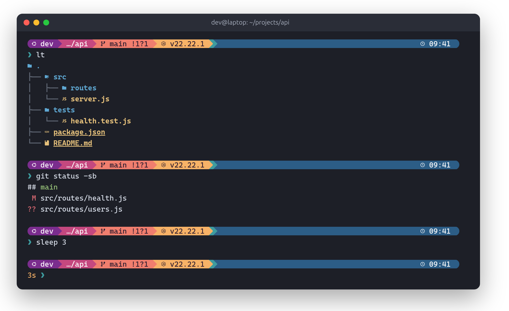
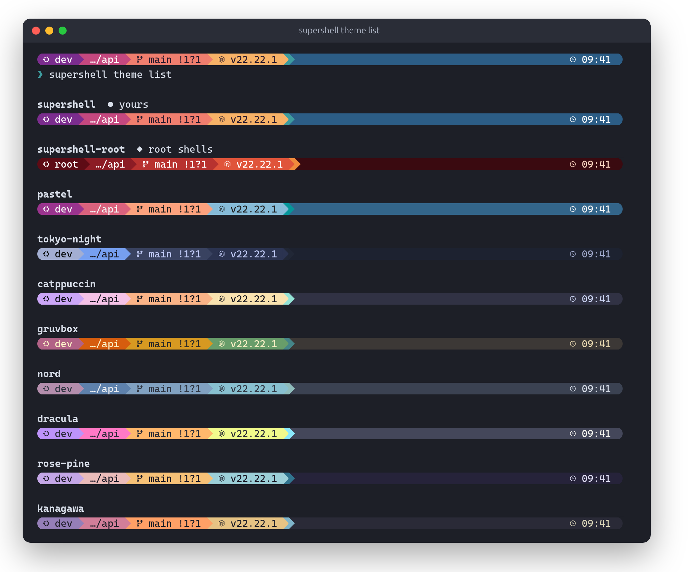
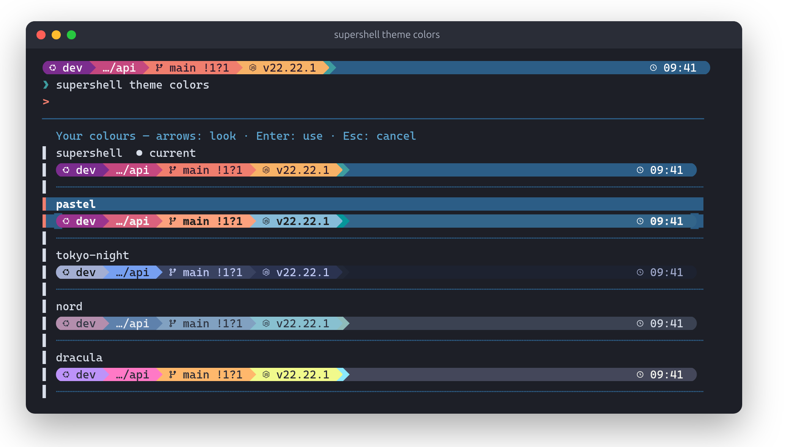
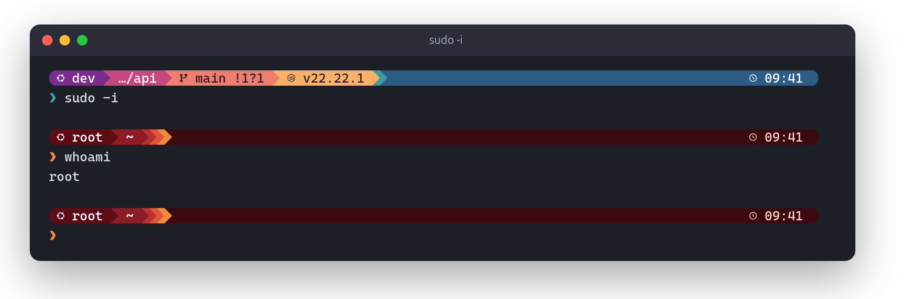
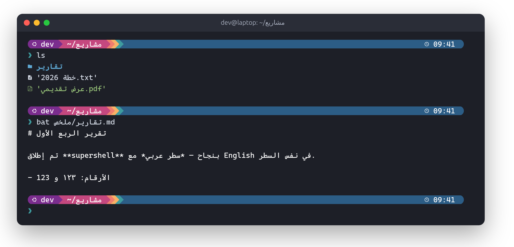
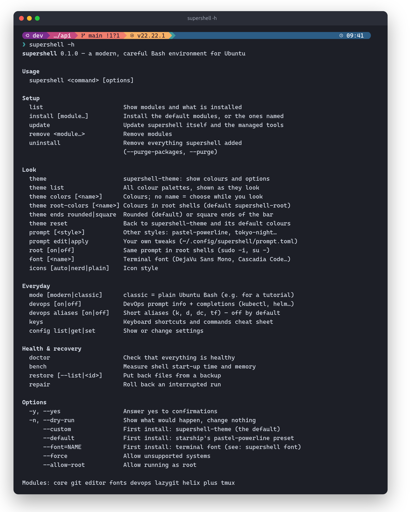

<div align="center">

# supershell

**A modern, careful Bash environment for Ubuntu 26.04**

A colour prompt that is ours, fuzzy search, smart navigation, readable Git diffs,
suggestions as you type, a ready-to-use Neovim and DevOps awareness —
while your shell stays plain Bash and every standard command works exactly as on
any other Ubuntu machine or server.

[](https://github.com/saeed-morshidy/supershell/actions/workflows/ci.yml)
[](LICENSE)


[العربية](README.ar.md) · [Install](#install) · [Themes](#supershell-theme) · [Commands](#commands) · [Docs](#documentation)



</div>

## Why supershell

- **Bash stays Bash.** `ls`, `cat`, `grep`, `find`, `cd`, `vi` are never redefined.
  New tools have their own names (`ll`, `lt`, `bat`, `rg`, `z`). Scripts, `scp` and
  `rsync` are unaffected: nothing runs in non-interactive shells.
- **One block in `~/.bashrc`.** Clearly marked, backed up first, removed byte-for-byte
  on uninstall.
- **Fast.** No framework, no daemons, no network at start-up; tool `init` output is
  cached. `supershell bench` shows the real cost on your machine.
- **Safe to try.** Every run is a transaction: if anything fails or you press Ctrl-C,
  it rolls back. `supershell mode classic` gives you stock Bash instantly.
- **Verified downloads.** Ubuntu packages first; anything else is a pinned release
  checked against its SHA-256. No `curl | sh`, ever.
- **Arabic is tested** — and its limits are documented honestly.

## Install

```bash
git clone https://github.com/saeed-morshidy/supershell.git
cd supershell
./supershell install --dry-run   # see exactly what would be installed, and from where
./supershell install             # the default modules
```

Then open a new terminal; `supershell doctor` checks everything.

The first install asks two questions — `--yes` takes the defaults:

| Question | Default | Other choices |
|---|---|---|
| **Prompt** | **supershell-theme** — supershell's own (below) | the starship pastel-powerline preset as published (`--default`) |
| **Terminal font** | Cascadia Code NF — Arabic built in, icons at full height; the bar's drawn rounded ends are made for it | DejaVu Sans Mono, JetBrains Mono, Fira Code, IBM Plex Mono, Ubuntu Sans Mono (`--font=NAME`) — all from Ubuntu's archive, Arabic always fixed-width |

**Requirements:** Ubuntu 26.04 LTS (24.04 and 25.10 best-effort), x86_64 or aarch64,
Bash 5.1+, `sudo` for apt packages (asked once). Run it as your normal user.

## supershell-theme

supershell's own prompt: a colour bar across the full terminal width with rounded
ends (or square: `supershell theme ends square`), git and language info in the middle, the clock at the right — and the command's
duration, exit status and Kubernetes context on the second line, in front of the `❯`.
It is a file in this repository, so it stays the same whatever starship ships.
The rounded ends are drawn by supershell itself (a two-glyph font, `Supershell Ends`):
the end's cell takes the bar colour as its background and the font only cuts the
corners in the terminal's own background colour, so the ends meet the bar exactly at
every font size and zoom, with any palette or terminal colours.

**Ten colour palettes**, each a smooth ramp from part to part — and `ll`, fzf, bat and
delta follow the palette you pick:



```bash
supershell theme list           # every palette, drawn as your real prompt
supershell theme colors         # choose while you look (arrows, Enter; Esc cancels)
supershell theme colors nord    # or by name
supershell theme ends square    # straight ends instead of rounded
supershell theme reset          # back to supershell-theme and its default colours
```

**Choose while you look** — `supershell theme colors` without a name:



**Root shells in red.** `supershell root on` gives `su -` / `sudo -i` the same prompt,
in the `supershell-root` palette so you always see that you are root. Root never reads
a file your normal account can change: the prompt is copied once, with sudo, into
root-owned places. Changing your colours later updates root's copy too.



```bash
supershell root on                      # once (asks for sudo)
supershell theme root-colors            # root's colours, chosen while you look
```

Want something else? `supershell prompt tokyo-night` (or `gruvbox-rainbow`,
`catppuccin-mocha`, `pastel-powerline`, `simple`), and your own tweaks in
`~/.config/supershell/prompt.toml` (`supershell prompt edit`) — applied on top of
any style, checked by starship before use. Details: [docs/configuration.md](docs/configuration.md).

## Arabic

Arabic file names, text and folders in the prompt work in Ptyxis (Ubuntu's terminal):
letters stay joined, Arabic runs right-to-left inside left-to-right lines, and fonts
without Arabic get it from a fixed-width font.



What is tested and what is not: [docs/arabic.md](docs/arabic.md) ·
[test plan](docs/arabic-test-plan.md) · [report](docs/reports/arabic-compatibility.md).

## Modules

| Module | Default | What you get |
|---|:---:|---|
| `core` | ✓ | [Starship](https://starship.rs) prompt, `fzf` (Ctrl-R / Ctrl-T / Alt-C), `zoxide` (`z`), `eza` (`ll`, `lt`), `bat`, `fd`, `rg` |
| `git` | ✓ | [delta](https://github.com/dandavison/delta) for readable diffs (one include line in `~/.gitconfig`) |
| `editor` | ✓ | Neovim 0.12 profile: LSP, completion, fuzzy find, git signs, file browser |
| `fonts` | ✓ | the terminal font you choose, Arabic in fixed-width cells, Nerd Font icons as a fallback (no patched fonts) |
| `devops` | ✓ | k8s context / docker context / terraform workspace in the prompt; completions for installed tools |
| `plus` | ✓ | suggestions as you type + syntax colours (ble.sh, from Ubuntu's package) + Atuin (local history search) — ~100 ms start-up; `supershell remove plus` for the fastest shell |
| `lazygit` | | full-screen Git UI |
| `helix` | | Helix (`hx`), a zero-config modal editor, as a second profile |
| `tmux` | | tmux with sensible defaults (never auto-started) |

```bash
supershell install lazygit tmux      # add modules
supershell remove helix              # remove one
supershell list                      # what's installed
```

### How to use each module

**`core`** — the prompt, plus faster ways to find and look at things. The originals
(`ls`, `cat`, `grep`, `find`) stay exactly as they are; the new tools have their own names.

| Type | What it does |
|---|---|
| `ll` · `la` · `lt` | list with git status and icons · including hidden files · as a tree (eza) |
| `bat file.py` | `cat` with syntax colours and line numbers |
| `rg "text"` | search file contents, fast (respects `.gitignore`) |
| `fd name` | find files by name |
| `z proj` · `zi` | jump to a folder you have visited · pick one from a list (zoxide) |
| `Ctrl-R` | search your command history |
| `Ctrl-T` | insert a file path, with a preview |
| `Alt-C` | jump into a sub-folder |
| `vim **<Tab>` / `cd **<Tab>` | fuzzy completion for any command |

**`git`** — `git diff`, `git show` and `git log -p` become readable side by side with
syntax colours (delta). In the diff, `n` / `N` jump to the next / previous file.

**`editor`** — `nvim` (Neovim 0.12; `snvim` if you keep your own `~/.config/nvim`).
Everything from `vi` works; the leader key is **Space** — press it and wait for a menu.

| Keys | What it does |
|---|---|
| `Space f` · `Space /` | find a file · search text in the project |
| `Space e` | file browser |
| `Space w` | save |
| `gd` · `gr` · `K` | go to definition · references · documentation |
| `Space ca` · `Space cr` · `Space cf` | code action · rename · format |
| `]d` `[d` · `]h` `[h` | next / previous problem · git change |

Language servers: `:SupershellLspInstall` once. More: [docs/editor.md](docs/editor.md).

**`fonts`** — `supershell font` lists the fonts, `supershell font cascadia-code` switches
(Ptyxis updates at once); `supershell config set font_size 14`.

**`devops`** — the prompt's second line shows the Kubernetes context (and namespace)
before you run anything; Docker context and Terraform workspace appear where they apply.
Tab completion is ready for `kubectl`, `helm`, `docker`, `terraform`, `gh`… (only the
ones installed). Short aliases are off until you ask: `supershell devops aliases on` →
`k` = kubectl, `d` = docker, `dc` = docker compose, `tf` = terraform.

**`plus`** — grey suggestions while you type, from your history: `→` (or `Ctrl-F`)
accepts it, keep typing to ignore it; commands are coloured as you type (red =
not found). `Ctrl-R` opens Atuin: history with folder and exit code, kept on your
machine (sync off); `Enter` puts the command on the line, `Enter` again runs it.
`↑` stays plain Bash history.

**`lazygit`** — `lg`: a full-screen Git UI (stage with `Space`, commit with `c`,
push with `P`, `?` for every key).

**`helix`** — `hx file`: a modal editor that needs no setup; `hx --tutor` once.

**`tmux`** — `tmux` (never started for you). The prefix is `Ctrl-B`, then `|` / `-`
split the window, `c` opens a window, `r` reloads the config.

## Commands

| Command | |
|---|---|
| `supershell theme …` | `list`, `colors`, `root-colors`, `reset` — see [supershell-theme](#supershell-theme) |
| `supershell prompt [<style>]` | other styles; `prompt edit` / `apply` for your own tweaks |
| `supershell root on\|off` | the same prompt in root shells — root-owned copies, prompt only |
| `supershell font [<name>]` | terminal font; Ptyxis updates right away |
| `supershell mode classic` / `modern` | plain Ubuntu Bash (e.g. while following a tutorial) / supershell |
| `supershell devops on\|off` · `devops aliases on` | DevOps info + completions · short aliases `k`, `d`, `dc`, `tf` (off by default) |
| `supershell doctor` · `bench` | health check · start-up time and memory, with and without supershell |
| `supershell update` · `restore` · `uninstall` | update · put back a file from a backup · remove everything (your files are kept) |

<details>
<summary><b>Full <code>supershell -h</code></b></summary>
<br>

</details>

Need the original command while an alias exists? `\ls` or `command ls`.
Disable supershell for one shell: `SUPERSHELL_DISABLE=1 bash`.

### Keyboard shortcuts

| Keys | Action |
|---|---|
| `Ctrl-R` | search command history (Atuin with `plus`, fzf otherwise) |
| `Ctrl-T` | insert a file path (with preview) |
| `Alt-C` | jump into a sub-folder |
| `z name` / `zi` | jump to a frequent folder / pick one interactively |
| `→` | accept the grey suggestion (`plus`) |

Editor shortcuts: [docs/editor.md](docs/editor.md).

## Documentation

- [Configuration](docs/configuration.md) · [Architecture](docs/architecture.md) · [Why these tools](docs/technology-selection.md) · [Editor](docs/editor.md)
- [Arabic support](docs/arabic.md) · [Troubleshooting](docs/troubleshooting.md) · [Known limitations](docs/known-limitations.md)
- [Testing](docs/testing.md) · Reports: [tests](docs/reports/test-results.md), [Arabic](docs/reports/arabic-compatibility.md), [performance](docs/reports/performance.md), [security & dependencies](docs/reports/security-dependencies.md)

The screenshots are real output — starship, eza, git, bat, fzf and the CLI — in a demo
home, regenerated with `scripts/screenshots/make.sh`.

## Contributing

Open source under the [MIT License](LICENSE). Everyone can fork and propose changes;
merging needs **3 maintainer approvals** — see [CONTRIBUTING.md](CONTRIBUTING.md),
[GOVERNANCE.md](GOVERNANCE.md) and [SECURITY.md](SECURITY.md).

## Acknowledgements

Ideas (not code) were learned from [Omakub](https://github.com/basecamp/omakub)
(a menu-driven setup with update/uninstall) and
[shell-bling-ubuntu](https://github.com/hiAndrewQuinn/shell-bling-ubuntu) (pinned
versions, test matrix), and from discussions in the Atuin, ble.sh and Neovim
communities. The rounded bar's spacing (icon right inside the rounded start, clock before the
rounded end) follows [typecraft](https://github.com/typecraft-dev/dotfiles)'s starship
prompt. Prompt presets and palettes build on [starship](https://starship.rs) and
the Catppuccin, Dracula, Gruvbox, Kanagawa, Nord, Rosé Pine and Tokyo Night colour
schemes. Thanks to egmont for the BiDi work in VTE that makes Arabic usable in
Ubuntu's terminal.
